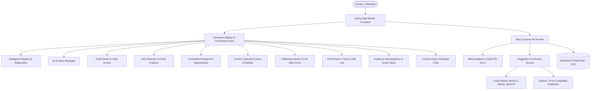

# AI Creator OS

> **Personal AI-Powered Instagram Content Strategist, Intelligence & Execution Platform**

**AI Creator OS** is a complete, production-oriented content intelligence workspace designed for high-signal creators. Rather than serving as a passive analytics dashboard, AI Creator OS analyzes your verified Instagram performance, learns your personal speaking cadence, identifies high-saving content patterns, writes ready-to-film scripts, audits video retention pacing, and proposes data-driven production schedules.

---

## 1. Core Platform Architecture



---

## 2. Technology Stack

* **Frontend**: Next.js 16 (App Router), TypeScript, Tailwind CSS, Lucide Icons, Recharts.
* **Backend**: Next.js API Routes, Server Actions, Meta Graph API v21.0 integration.
* **Database**: PostgreSQL through Supabase with Row Level Security (RLS) policies and in-memory local state fallback.
* **AI Provider Layer**: Pluggable provider architecture supporting local **Ollama** (`http://localhost:11434`), **OpenAI-compatible APIs** (OpenAI, Groq, OpenRouter), and built-in heuristic intelligence.
* **Media & Video Analysis**: Client-side HTML5 Video/Canvas metadata extraction (duration, resolution, fps, aspect ratio) combined with structured narrative retention breakdown.

---

## 3. Platform Modules & Features

### 1. Home Command Center (`/`)
* Account telemetry: Followers, reach, views, engagement rate, top-performing post spotlight.
* **"WHAT SHOULD I DO TODAY?"**: AI prioritized 4-step actionable daily checklist linking directly to scripts and audits.
* **Quick Action**: "Generate My Next Content Plan" with 7-day auto-scheduling.

### 2. Instagram Analytics Dashboard (`/analytics`)
* Verified metrics queried from Meta Graph API v21.0 (Reach, Impressions, Views, Likes, Comments, Shares, Saves, Engagement Rate).
* Comparative periods (Last 7d vs Previous 7d; Last 30d vs Previous 30d).
* Follower velocity and daily net growth bar charts.
* Sortable content performance library with AI diagnostic modal (What worked, What limited, Next test).

### 3. AI Content Strategist (`/strategist`)
* 5 evidence-based recommendations answering: What to post, Why, Evidence, Format, Hook, What video shows, What to say, and Objective.
* Confidence scores and estimated production effort.
* One-click actions: Generate script, Save idea, Add to calendar, Mark filmed.

### 4. Content Ideas Library (`/ideas`)
* Searchable, filterable idea catalog (Topic, Format, Objective, Difficulty, Status).
* AI Idea Generator modal with custom topic, goal, format, and count parameters.
* Manual idea creator and favorite starring.

### 5. Script Studio & Voice Profile (`/scripts`)
* 3 tested alternative hooks selector with one-click swap.
* Spoken teleprompter editor with reading speed benchmark (145 wpm), word count, and duration estimation.
* AI polish toolbar: **Naturalize Voice** (strips corporate fluff), **Shorten (30%)**, and **Expand with Proof**.
* Shot-by-shot visual director table (Visual framing, Spoken line, On-screen text, Duration).
* **Personal Voice Profile**: Configure cadence, directness (1-10), humor level, banned corporate words list, and sample writing ingestion.

### 6. Reel Video Analyzer (`/reel-analyzer`)
* Video file uploader with client-side metadata extraction (duration, resolution, aspect ratio, file size).
* Hook strength score (0-100) and scroll-stopping critique.
* Narrative section flow breakdown with start/end timestamps.
* Repetition detector and AI-tightened revised script.
* Pre-publication safety checklist.

### 7. Competitor Research Dashboard (`/competitor`)
* Public post reference tracker with observable engagement signals.
* Reverse-engineered narrative and hook breakdown.
* Original content opportunity matrix with one-click idea conversion.

### 8. Content Calendar (`/calendar`)
* Month/Week grid and list views with status filters (`idea`, `planned`, `script_ready`, `filming`, `ready`, `scheduled`, `published`).
* **"Plan My Next 7 Days"** AI auto-scheduler with schedule approval dialog.

### 9. Publishing Studio (`/publishing`)
* Instagram 9:16 mobile safe-zone visual preview with simulated platform overlays.
* Pre-flight safety checklist (vertical format, hook timing, audio normalization, safe-zone clearance).
* Direct Instagram container publishing for supported accounts.
* Assisted manual publishing workflow with one-click caption and hashtag stack copying.

### 10. Performance Coach (`/coach`)
* Causation-isolated post diagnostics: What worked, What limited, What remains uncertain, Benchmark comparison.
* **Experiment Lab**: Structured creator A/B hypothesis tracker (Hook Style, Format, Posting Time, Video Length).

### 11. Audience Insights (`/audience`)
* Demographic age distribution (76% 18-34 tech builders).
* Geographic breakdown of top creator markets (US, India, UK, Germany, Canada).
* Active audience peak hours heatmap (6:00 PM - 9:00 PM EST).
* AI audience-tailored content angles.

### 12. AI Strategist Chat (`/chat`)
* Conversational assistant with authorized access to creator telemetry.
* Prompt suggestion chips for rapid strategic querying.
* Action conversion toolbar on every assistant response (Convert to Idea, Add to Calendar, Copy).

### 13. Reports & Settings (`/reports`, `/settings`)
* Weekly and monthly audited performance briefs with printable PDF formatting and CSV/JSON data download.
* Open-source AI provider settings with live connection tester (Ollama / OpenAI / Custom).
* Meta Instagram token lifecycle and secure account disconnect.

---

## 4. Local Installation & Quick Start

### Prerequisites
* **Node.js**: v18.18.0 or newer (v24 LTS recommended)
* **npm**: v10+
* **Ollama** (optional for local offline AI): [https://ollama.com](https://ollama.com)

### Installation Steps

```bash
# 1. Clone repository
git clone https://github.com/your-username/ai-creator-os.git
cd ai-creator-os

# 2. Install dependencies
npm install

# 3. Configure environment variables
cp .env.example .env.local

# 4. Run automated test suite
npm test

# 5. Start development server
npm run dev
```

Open **`http://localhost:3000`** in your browser to enter the creator workspace.

---

## 5. Setting Up Local Ollama AI Models

AI Creator OS runs natively with local, open-weight models for 100% privacy and zero cloud API expenses.

1. **Install Ollama**: Follow instructions at [ollama.com](https://ollama.com).
2. **Pull the recommended text model**:
   ```bash
   ollama pull llama3.2
   ```
3. **Start the Ollama server**:
   ```bash
   ollama serve
   ```
4. **Test in App**: Navigate to **Settings &rarr; AI Inference System** and click **Test Connection**.

---

## 6. Setting Up Meta Instagram Graph API

To connect a live Instagram account:

1. Register as a Meta Developer at [developers.facebook.com](https://developers.facebook.com).
2. Create an App with the **Business** use case.
3. Add the **Instagram Graph API** product.
4. Add the following permissions:
   * `instagram_basic`
   * `instagram_manage_insights`
   * `pages_show_list`
   * `pages_read_engagement`
   * `instagram_content_publish`
5. Configure the OAuth Redirect URI:
   `http://localhost:3000/api/instagram/callback`
6. Add your `META_APP_ID` and `META_APP_SECRET` to `.env.local`.

*Note: If Meta API credentials are not yet configured, the app provides a full-fidelity **Demo Mode** featuring 24 authentic creator Reels, historical growth curves, and verified diagnostic benchmarks.*

---

## 7. Database & Supabase PostgreSQL Setup

The project includes a production-grade PostgreSQL schema with full Row Level Security (RLS) policies.

1. Create a Supabase project at [supabase.com](https://supabase.com).
2. Run the SQL migration script located in [`src/lib/supabase/schema.sql`](src/lib/supabase/schema.sql) in the Supabase SQL Editor.
3. Copy your project URL and Anon Key into `.env.local`:
   ```env
   NEXT_PUBLIC_SUPABASE_URL=https://your-project.supabase.co
   NEXT_PUBLIC_SUPABASE_ANON_KEY=your-anon-key
   ```

---

## 8. Automated Test Suite

Run the built-in unit tests covering analytics calculations, auth expiration, calendar conflict avoidance, voice profile filters, and video duration calculations:

```bash
npm test
```

---

## 9. License

MIT License. Designed and engineered for high-signal content creators and solopreneurs.
